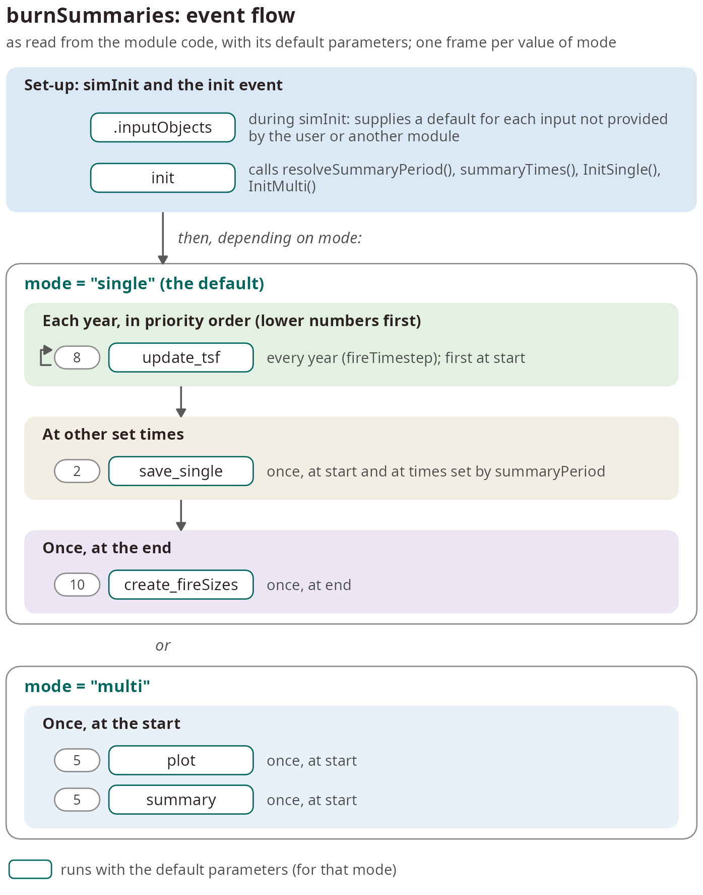
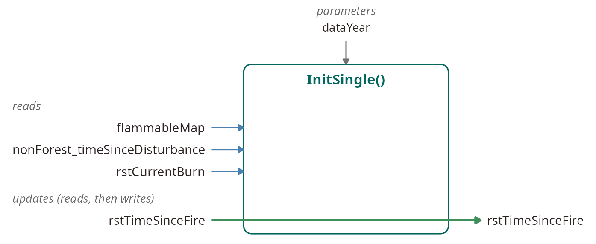
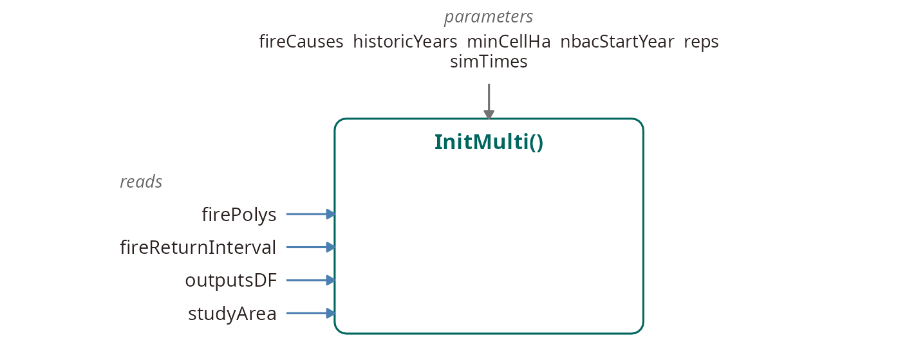
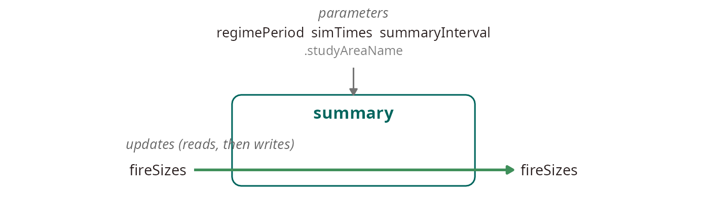

# burnSummaries Module

<!-- the following are text references used in captions for LaTeX compatibility -->
(ref:burnSummaries) *burnSummaries*

(ref:percent) %

#### Authors:

Alex M Chubaty <achubaty@for-cast.ca> [aut, cre] (ORCID: <https://orcid.org/0000-0001-7146-8135>)
<!-- ideally separate authors with new lines, '\n' not working -->

:::{.rmdwarning}
This documentation is work in progress.
Please report any discrepancies or omissions at <https://github.com/PredictiveEcology/burnSummaries/issues>.
:::

## Module Overview

### Module summary

burnSummaries records the fires a fire model simulates and summarizes the fire regime they make, beside the observed fire record.
It reads the burn outputs of three fire models:

- LandMine [@Andison:1996], based on [@Clarke:1994];
- scfm [@Cumming:1998; @Armstrong:2003];
- fireSense [@Marchal:2017a; @Marchal:2017b; @Marchal:2019].

It runs in one of two modes (parameter `mode`):

- **single**, in each replicate, alongside the fire model.
  It keeps the map of time since fire, which is reset to 0 in the year a cell burns, and saves it at the start of the run, in each summary year and at the end.
  At the end of the run it writes the size of every fire, the cumulative burn map and the flammability map.
- **multi**, once, after the replicates have run.
  It reads every replicate's saved outputs and maps the mean annual area burned, across the replicates and from the observed fire record, on the same burnable cells.
  It then tabulates the fire regime of each replicate and of the observed record (number of fires, area burned per year and largest fire), and the fire in each block of `summaryInterval` years.

The observed record is the National Burned Area Composite (NBAC) perimeters from `nbacStartYear` (1972) on, and the National Fire Database (NFDB) polygons for earlier years.

### Fire-regime metrics

The simulated and observed fire regimes are summarized over the same land: the burnable cells, which are flammable, inside the study area and have a fire return interval.

#### Mean annual burn rate and fire cycle

The mean annual burn rate is the share of the burnable area that burns per year: over the replicates and years of the run for the simulated rate, and over the years of record for the observed one.
@Johnson:1985 call it the annual percent burned.
Its reciprocal is the fire cycle, the time needed to burn an area equal to the study area [@VanWagner:1978; @Johnson:1994], which @Li:2002 treats as the same quantity as the fire rotation, the return period and the fire return interval (the name of LandMine's input).
Each part of the study area need not burn once in a fire cycle, only an area equal to it, so area that burns again counts again [@Johnson:1994; @Li:2002].

The two burn maps give the rate for cells of at least 100 ha (by default), as the mean annual share of each cell's burnable area that burned.
A year counts once in a cell, however many perimeters overlap there.
In the fire-regime table, the observed area burned per year is this share times each cell's burnable area, summed over the cells.
The simulated area burned per year is the sum of the replicate's fire sizes over its years, which can include land outside the burnable cells, as fire sizes carry no locations.

The observed rate is the area burned divided by the length of the record, years without fire included [@Li:2002].
The record is the years set by `historicYears`, or else the first to the last year of the record itself.
Leaving out fire-free years at either end of a record would overstate the rate.

Area burned varies greatly from year to year.
For the boreal mixedwood of northeastern Alberta, @Armstrong:1999 characterized annual area burned as independent draws from a lognormal distribution, and found by simulation that mean annual burn rates estimated from it were highly imprecise, even from long records.
In a simulated landscape, @Li:2002 needed 35 to 40 years of annual fire maps for a stable estimate of the fire cycle, and noted that fire records usually cover much less time than a fire cycle, so that a reliable estimate is unlikely.
Li suggested that fire cycles remain useful for comparing regions or vegetation types when the same method is applied to each over the same period.
The fire-per-block figure shows how much the simulated area burned varies between blocks of years and between replicates, beside the single observed rate.

#### Time since fire

Time since fire is the number of years since a cell last burned, and is 0 in the year it burns.
When every cell has the same chance of burning each year, whatever its age, time since fire follows a negative exponential distribution, with a mean equal to the fire cycle [@VanWagner:1978; @Johnson:1985; @Johnson:1994].
One landscape at one time comes close to that distribution only when it is large compared with its fires and the burn rate does not vary between years [@Boychuk:1997].
When the burn rate varies between years, the age distribution of one landscape varies widely around the negative exponential, even at very large scales, and only its average over time is exponential [@Boychuk:1997]; @Armstrong:1999 found no equilibrium age distribution under a highly variable annual burn rate.
A simulated map of time since fire therefore need not look like the negative exponential to be correct.

#### Number of fires and largest fire

Each replicate's number of fires and largest fire cover the years of the run, or the years set by `regimePeriod`.
LandMine records a fire that runs short of its target size and is re-ignited as several pieces, which together are one fire; the pieces need not be contiguous, so a mapped record could show such a fire as several perimeters.
Each observed perimeter is one fire, counted when it covers burnable land, and its size is the burnable land inside it.

Most fires are small, but a few large ones burn most of the area: in Canada in 1959 to 1997, fires larger than 200 ha were 3.1% of all fires and accounted for about 97% of the area burned [@Stocks:2002].
Several national analyses of fire regimes count only fires of 200 ha or more [@Stocks:2002; @Parisien:2006; @Hanes:2019].
burnSummaries counts fires of every size, down to one cell for the simulated fires and to the smallest fire mapped in the observed record.
Fires that go undetected are usually small, so they change the number of fires much more than the area burned or the fire cycle, and the number of fires recorded can change over time with the ability to detect fires in remote areas [@Li:2002].
Area burned is the more reliable comparison.

#### Fire sizes

Fire sizes span several orders of magnitude, so the fire-size figures count fires in bins of the logarithm of size.
burnSummaries fits no distribution to them.
Distributions fitted to fire sizes include a power law [@Malamud:1998], other parametric models where a single power law does not fit the full range of sizes [@Reed:2002], and an exponential distribution of the logarithm of size with an upper bound on size [@Cumming:2001].
For LandMine, the expected sizes are the target size drawn for each fire, compared with the area the fire burned in all its pieces.

#### The observed record

NBAC combines fire polygons mapped from 30 m Landsat imagery with high-quality agency polygons, and maps the remaining fires from coarser satellite data [@Hall:2020].
Mapped fire perimeters include unburned patches.
For the fires of 1984 to 2009 in Yosemite and Glacier national parks and the Yukon-Charley Rivers National Preserve in Alaska, 35%, 14% and 13% of the area inside fire perimeters was unburned [@Kolden:2012, p. 42].
For 24 fires in the Alberta foothills, all six burn-pattern metrics measured were sensitive to how a fire's boundary was drawn [@Andison:2012], and fire management agencies remove unburned islands from their perimeters inconsistently [@Hall:2020].
burnSummaries counts a cell as burned when a perimeter covers its centre, so the observed burn rate includes unburned patches inside perimeters, while the simulated rate counts only the cells a fire burned.

The observed record is also not a constant baseline.
Nationally, area burned and the number of fires of 200 ha or more increased in Canada from 1959 to 2015 [@Hanes:2019].
Fire cycles in the boreal forest have also changed over past centuries [@Bergeron:2004], with climate and with land use around a study area [@Weir:2000].
Comparing the simulated regime with the observed one treats the record as one sample of the range of variation of the fire regime [@Landres:1999; @Keane:2009], and no single period or extent defines that range [@Landres:1999].

#### Where the metrics are

- Mean annual burn rate: `meanAnnualCumulBurnMap.tif` (simulated) and `meanAnnualCumulBurnMapHistoric.tif` (observed); cell size from `minCellHa`.
- Area burned per year, number of fires and largest fire: `burnSummaries_fireRegime.csv`, one row per replicate and one for the observed record; years from `regimePeriod` and `historicYears`.
- Fire per block of `summaryInterval` years: `burnSummaries_fireBlocks.csv` and the `fire_per_block` figure.
- Time since fire: `rstTimeSinceFire_year<year>.tif`.
- Fire sizes: `burnSummaries_fireSizes_allReps.csv` (one row per LandMine piece) and the fire-size figures (one per fire).

### Module inputs and parameters

Table \@ref(tab:moduleInputs-burnSummaries) shows the full list of module inputs.

In single mode the module needs the fire model's flammability map (`flammableMap`, or fireSense's `flammableRTM`), its map of the year's burn (`rstCurrentBurn`) and cumulative burn map (`burnMap`), and its fire sizes: `burnSummary` from scfm or fireSense, or `fireSizes` from LandMine.
The starting time since fire is `rstTimeSinceFire` when supplied; otherwise fireSense's `nonForest_timeSinceDisturbance`, or else the SCANFI stand age of `dataYear`, with non-flammable cells set to `NA`.
In multi mode it reads the replicates' saved files, listed in `outputsDF` or found under `outputPath(sim)/rep<NN>`.
`studyArea` and `fireReturnInterval`, when supplied, limit both burn maps to the cells inside the study area that have a fire return interval; `firePolys` replaces the download of the observed fire record.

<table class="table" style="width: auto !important; margin-left: auto; margin-right: auto;">
<caption>(\#tab:moduleInputs-burnSummaries)(\#tab:moduleInputs-burnSummaries)List of (ref:burnSummaries) input objects and their description.</caption>
 <thead>
  <tr>
   <th style="text-align:left;"> objectName </th>
   <th style="text-align:left;"> objectClass </th>
   <th style="text-align:left;"> desc </th>
   <th style="text-align:left;"> sourceURL </th>
  </tr>
 </thead>
<tbody>
  <tr>
   <td style="text-align:left;"> burnMap </td>
   <td style="text-align:left;"> SpatRaster </td>
   <td style="text-align:left;"> Cumulative burn map. Required in single mode. </td>
   <td style="text-align:left;"> NA </td>
  </tr>
  <tr>
   <td style="text-align:left;"> burnSummary </td>
   <td style="text-align:left;"> data.table </td>
   <td style="text-align:left;"> Fire summary table from `fireSense_burn` or `scfm`. One of `burnSummary` or `fireSizes` is required in single mode. </td>
   <td style="text-align:left;"> NA </td>
  </tr>
  <tr>
   <td style="text-align:left;"> firePolys </td>
   <td style="text-align:left;"> list </td>
   <td style="text-align:left;"> Optional, multi mode. List of `SpatVector` polygons of observed fires, each with a `YEAR` column. If not supplied, NBAC perimeters (with NFDB backfill) are downloaded. </td>
   <td style="text-align:left;"> NA </td>
  </tr>
  <tr>
   <td style="text-align:left;"> fireReturnInterval </td>
   <td style="text-align:left;"> SpatRaster </td>
   <td style="text-align:left;"> Fire return interval (years), on the grid of the saved `flammableMap`; LandMine's input of that name. Multi mode, optional: both burn maps are restricted to cells with an interval (not NA, above 0), the cells where LandMine ignites fires. </td>
   <td style="text-align:left;"> NA </td>
  </tr>
  <tr>
   <td style="text-align:left;"> fireSizes </td>
   <td style="text-align:left;"> list </td>
   <td style="text-align:left;"> Fire sizes summary tables from LandMine. One of `burnSummary` or `fireSizes` is required in single mode. </td>
   <td style="text-align:left;"> NA </td>
  </tr>
  <tr>
   <td style="text-align:left;"> flammableMap </td>
   <td style="text-align:left;"> SpatRaster </td>
   <td style="text-align:left;"> Binary flammability map. Required in single mode. </td>
   <td style="text-align:left;"> NA </td>
  </tr>
  <tr>
   <td style="text-align:left;"> outputsDF </td>
   <td style="text-align:left;"> data.table </td>
   <td style="text-align:left;"> Optional, multi mode. The rbindlisted `outputs(sim)` of all the sims being summarised, i.e., all the files that may exist. If not supplied, files are read from `outputPath(sim)/rep&lt;NN&gt;`. </td>
   <td style="text-align:left;"> NA </td>
  </tr>
  <tr>
   <td style="text-align:left;"> nonForest_timeSinceDisturbance </td>
   <td style="text-align:left;"> SpatRaster </td>
   <td style="text-align:left;"> map of time since last burn, with non-flammable pixels receiving `NA`. One of `rstTimeSinceFire` or `nonForest_timeSinceDisturbance` is required in single mode. </td>
   <td style="text-align:left;"> NA </td>
  </tr>
  <tr>
   <td style="text-align:left;"> rstCurrentBurn </td>
   <td style="text-align:left;"> SpatRaster </td>
   <td style="text-align:left;"> Binary raster of fires, 1 meaning 'burned', 0 or NA is non-burned </td>
   <td style="text-align:left;"> NA </td>
  </tr>
  <tr>
   <td style="text-align:left;"> rstTimeSinceFire </td>
   <td style="text-align:left;"> SpatRaster </td>
   <td style="text-align:left;"> map of time since last burn, with non-flammable pixels receiving `NA`. One of `rstTimeSinceFire` or `nonForest_timeSinceDisturbance` is required in single mode. </td>
   <td style="text-align:left;"> NA </td>
  </tr>
  <tr>
   <td style="text-align:left;"> studyArea </td>
   <td style="text-align:left;"> SpatVector </td>
   <td style="text-align:left;"> Polygon of the area the fire model burns; LandMine's input of that name. Multi mode, optional: both burn maps are restricted to cells whose centre is inside it. An `sf` object is also accepted. </td>
   <td style="text-align:left;"> NA </td>
  </tr>
</tbody>
</table>

Table \@ref(tab:moduleParams-burnSummaries) lists the parameters.
`summaryPeriod` and `summaryInterval` set the years in which time since fire is saved and the length of the blocks in the fire tables; with `summaryPeriod` unset, the summaries cover the last 30% of the run (years 700 to 1000 of a run of 1000 years or more).
In multi mode, `reps` lists the replicates, `simTimes` gives the start and end of their runs, `regimePeriod` limits the years of the simulated fire regime, and `historicYears` limits the years of the observed record.

<table class="table" style="width: auto !important; margin-left: auto; margin-right: auto;">
<caption>(\#tab:moduleParams-burnSummaries)(\#tab:moduleParams-burnSummaries)List of (ref:burnSummaries) parameters and their description.</caption>
 <thead>
  <tr>
   <th style="text-align:left;"> paramName </th>
   <th style="text-align:left;"> paramClass </th>
   <th style="text-align:left;"> default </th>
   <th style="text-align:left;"> min </th>
   <th style="text-align:left;"> max </th>
   <th style="text-align:left;"> paramDesc </th>
   <th style="text-align:left;"> cacheKey </th>
  </tr>
 </thead>
<tbody>
  <tr>
   <td style="text-align:left;"> dataYear </td>
   <td style="text-align:left;"> numeric </td>
   <td style="text-align:left;"> 2020 </td>
   <td style="text-align:left;"> NA </td>
   <td style="text-align:left;"> NA </td>
   <td style="text-align:left;"> data year for the SCANFI stand-age inputs used to seed rstTimeSinceFire (single mode) </td>
   <td style="text-align:left;"> TRUE </td>
  </tr>
  <tr>
   <td style="text-align:left;"> fireCauses </td>
   <td style="text-align:left;"> character </td>
   <td style="text-align:left;">  </td>
   <td style="text-align:left;"> NA </td>
   <td style="text-align:left;"> NA </td>
   <td style="text-align:left;"> (multi mode) cause groups of the observed fires the historic burn map and the observed row of the fire regime table count, any of 'natural', 'unknown', 'human' and 'other' (`fireregimetools::fire_cause_group()` says which NBAC `FIRECAUS` and NFDB `CAUSE` values are which). `NULL` (default) keeps every cause; set it to the causes the fire model is fitted to, e.g. `c('natural', 'unknown')` for fireSense. Prescribed burns are always left out. </td>
   <td style="text-align:left;"> TRUE </td>
  </tr>
  <tr>
   <td style="text-align:left;"> fireTimestep </td>
   <td style="text-align:left;"> integer </td>
   <td style="text-align:left;"> 1 </td>
   <td style="text-align:left;"> NA </td>
   <td style="text-align:left;"> NA </td>
   <td style="text-align:left;"> simulation time interval between burn events </td>
   <td style="text-align:left;"> TRUE </td>
  </tr>
  <tr>
   <td style="text-align:left;"> historicYears </td>
   <td style="text-align:left;"> integer </td>
   <td style="text-align:left;"> NA, NA </td>
   <td style="text-align:left;"> NA </td>
   <td style="text-align:left;"> NA </td>
   <td style="text-align:left;"> (multi mode) first and last year of the observed fire record used for the historic mean annual burn map and the observed row of the fire regime table, e.g. `c(1985L, 2024L)`. `NA` (the default) uses every year the record holds. </td>
   <td style="text-align:left;"> TRUE </td>
  </tr>
  <tr>
   <td style="text-align:left;"> mode </td>
   <td style="text-align:left;"> character </td>
   <td style="text-align:left;"> single </td>
   <td style="text-align:left;"> NA </td>
   <td style="text-align:left;"> NA </td>
   <td style="text-align:left;"> use 'single' to run part of a simulation; use 'multi' to run as part of postprocessing multiple runs. </td>
   <td style="text-align:left;"> TRUE </td>
  </tr>
  <tr>
   <td style="text-align:left;"> minCellHa </td>
   <td style="text-align:left;"> numeric </td>
   <td style="text-align:left;"> 100 </td>
   <td style="text-align:left;"> 0 </td>
   <td style="text-align:left;"> NA </td>
   <td style="text-align:left;"> (multi mode) smallest cell (ha) of the two mean annual burn maps. Fire perimeters are only meaningful at about 100 ha, so both maps are aggregated from the grid of `flammableMap` by the smallest whole factor whose cell is at least this large (240 m cells: factor 5, 1.2 km, 144 ha). Values are the mean annual share of the cell's burnable area burned. </td>
   <td style="text-align:left;"> TRUE </td>
  </tr>
  <tr>
   <td style="text-align:left;"> nbacStartYear </td>
   <td style="text-align:left;"> integer </td>
   <td style="text-align:left;"> 1972 </td>
   <td style="text-align:left;"> NA </td>
   <td style="text-align:left;"> NA </td>
   <td style="text-align:left;"> first year of the historic fire record (multi mode) taken from NBAC perimeters; earlier years come from NFDB polygons. NBAC begins in 1972. </td>
   <td style="text-align:left;"> TRUE </td>
  </tr>
  <tr>
   <td style="text-align:left;"> regimePeriod </td>
   <td style="text-align:left;"> integer </td>
   <td style="text-align:left;"> NA, NA </td>
   <td style="text-align:left;"> NA </td>
   <td style="text-align:left;"> NA </td>
   <td style="text-align:left;"> (multi mode) first and last simulation year the simulated rows of `burnSummaries_fireRegime.csv` cover: fires in the years after the first up to and including the last, e.g. `c(700L, 1000L)` to leave out a run's transient. `NA` (the default) covers the whole run, `simTimes`. </td>
   <td style="text-align:left;"> TRUE </td>
  </tr>
  <tr>
   <td style="text-align:left;"> reps </td>
   <td style="text-align:left;"> integer </td>
   <td style="text-align:left;"> 1, 2, 3,.... </td>
   <td style="text-align:left;"> 1 </td>
   <td style="text-align:left;"> NA </td>
   <td style="text-align:left;"> in single mode, should be length 1 indicating the replicate id; in multi mode, a vector of replicate IDs. </td>
   <td style="text-align:left;"> TRUE </td>
  </tr>
  <tr>
   <td style="text-align:left;"> simOutputPath </td>
   <td style="text-align:left;"> character </td>
   <td style="text-align:left;"> /tmp/Rtm.... </td>
   <td style="text-align:left;"> NA </td>
   <td style="text-align:left;"> NA </td>
   <td style="text-align:left;"> Directory specifying the location of the simulation outputs. </td>
   <td style="text-align:left;"> FALSE </td>
  </tr>
  <tr>
   <td style="text-align:left;"> simTimes </td>
   <td style="text-align:left;"> numeric </td>
   <td style="text-align:left;"> NA, NA </td>
   <td style="text-align:left;"> NA </td>
   <td style="text-align:left;"> NA </td>
   <td style="text-align:left;"> Simulation start and end times when running in 'multi' mode. </td>
   <td style="text-align:left;"> TRUE </td>
  </tr>
  <tr>
   <td style="text-align:left;"> summaryInterval </td>
   <td style="text-align:left;"> integer </td>
   <td style="text-align:left;"> 100 </td>
   <td style="text-align:left;"> NA </td>
   <td style="text-align:left;"> NA </td>
   <td style="text-align:left;"> simulation time interval at which to take 'snapshots' used for summary analyses </td>
   <td style="text-align:left;"> TRUE </td>
  </tr>
  <tr>
   <td style="text-align:left;"> summaryPeriod </td>
   <td style="text-align:left;"> integer </td>
   <td style="text-align:left;"> NA, NA </td>
   <td style="text-align:left;"> NA </td>
   <td style="text-align:left;"> NA </td>
   <td style="text-align:left;"> lower and upper end of the range of simulation times used for summary analyses. `NA` (the default) means the last 30% of the run, which is years 700 to 1000 of a 1000-year run; a run shorter than 1000 years gets a message with the period chosen. </td>
   <td style="text-align:left;"> TRUE </td>
  </tr>
  <tr>
   <td style="text-align:left;"> .plots </td>
   <td style="text-align:left;"> character </td>
   <td style="text-align:left;"> png </td>
   <td style="text-align:left;"> NA </td>
   <td style="text-align:left;"> NA </td>
   <td style="text-align:left;"> Used by `Plots` function, which can be optionally used here. </td>
   <td style="text-align:left;"> TRUE </td>
  </tr>
  <tr>
   <td style="text-align:left;"> .plotInitialTime </td>
   <td style="text-align:left;"> numeric </td>
   <td style="text-align:left;"> 0 </td>
   <td style="text-align:left;"> NA </td>
   <td style="text-align:left;"> NA </td>
   <td style="text-align:left;"> Describes the simulation time at which the first plot event should occur. </td>
   <td style="text-align:left;"> TRUE </td>
  </tr>
  <tr>
   <td style="text-align:left;"> .plotInterval </td>
   <td style="text-align:left;"> numeric </td>
   <td style="text-align:left;"> NA </td>
   <td style="text-align:left;"> NA </td>
   <td style="text-align:left;"> NA </td>
   <td style="text-align:left;"> Describes the simulation time interval between plot events. </td>
   <td style="text-align:left;"> TRUE </td>
  </tr>
  <tr>
   <td style="text-align:left;"> .saveInitialTime </td>
   <td style="text-align:left;"> numeric </td>
   <td style="text-align:left;"> NA </td>
   <td style="text-align:left;"> NA </td>
   <td style="text-align:left;"> NA </td>
   <td style="text-align:left;"> Describes the simulation time at which the first save event should occur. </td>
   <td style="text-align:left;"> TRUE </td>
  </tr>
  <tr>
   <td style="text-align:left;"> .saveInterval </td>
   <td style="text-align:left;"> numeric </td>
   <td style="text-align:left;"> NA </td>
   <td style="text-align:left;"> NA </td>
   <td style="text-align:left;"> NA </td>
   <td style="text-align:left;"> This describes the simulation time interval between save events. </td>
   <td style="text-align:left;"> TRUE </td>
  </tr>
  <tr>
   <td style="text-align:left;"> .studyAreaName </td>
   <td style="text-align:left;"> character </td>
   <td style="text-align:left;"> NA </td>
   <td style="text-align:left;"> NA </td>
   <td style="text-align:left;"> NA </td>
   <td style="text-align:left;"> Human-readable name for the study area used - e.g., a hash of the studyarea obtained using `reproducible::studyAreaName()` </td>
   <td style="text-align:left;"> TRUE </td>
  </tr>
  <tr>
   <td style="text-align:left;"> .rep </td>
   <td style="text-align:left;"> integer </td>
   <td style="text-align:left;"> NA </td>
   <td style="text-align:left;"> NA </td>
   <td style="text-align:left;"> NA </td>
   <td style="text-align:left;"> (single mode) the replicate this run is; `setupProject()` sets it from `.globals$.rep`. `NA` (the default): `reps` when it names one replicate, else the last `repNN` folder of `outputPath`. </td>
   <td style="text-align:left;"> TRUE </td>
  </tr>
  <tr>
   <td style="text-align:left;"> .seed </td>
   <td style="text-align:left;"> list </td>
   <td style="text-align:left;">  </td>
   <td style="text-align:left;"> NA </td>
   <td style="text-align:left;"> NA </td>
   <td style="text-align:left;"> Named list of seeds to use for each event (names). </td>
   <td style="text-align:left;"> TRUE </td>
  </tr>
  <tr>
   <td style="text-align:left;"> .useCache </td>
   <td style="text-align:left;"> logical </td>
   <td style="text-align:left;"> FALSE </td>
   <td style="text-align:left;"> NA </td>
   <td style="text-align:left;"> NA </td>
   <td style="text-align:left;"> Should caching of events or module be used? </td>
   <td style="text-align:left;"> TRUE </td>
  </tr>
</tbody>
</table>

### Events

In single mode:

- `init` resolves the summary period, sets the starting time since fire if none was supplied, and checks that the maps share one grid.
- `update_tsf`, every `fireTimestep` years after the fire model's burn, adds `fireTimestep` to time since fire and sets the cells burned that year to 0.
- `save_single` saves time since fire at the start of the run, in each summary year and at the end, and at the end also the cumulative burn map and the flammability map.
- `create_fireSizes`, at the end of the run, writes the replicate's fire sizes.

In multi mode:

- `init` reads the replicates' burn and flammability maps, fetches the observed fire record unless `firePolys` is supplied, and makes and saves the simulated and observed mean annual burn maps.
- `summary` combines the fire sizes of all replicates and writes the fire-regime and fire-per-block tables.
- `plot` draws the figures.

(\#fig:eventFlow-burnSummaries)(ref:burnSummaries) events, as read from the module code with its default parameters.

Table \@ref(tab:eventObjects-burnSummaries) lists, for each object, the code that writes it and the code that only reads it.

<table class="table" style="width: auto !important; border-bottom: 0;">
<caption>(\#tab:eventObjects-burnSummaries)Where each object of (ref:burnSummaries) is written and read, in run order.</caption>
 <thead>
  <tr>
   <th style="text-align:left;"> Object </th>
   <th style="text-align:left;"> Written by </th>
   <th style="text-align:left;"> Read by </th>
  </tr>
 </thead>
<tbody>
  <tr grouplength="7"><td colspan="3" style="border-bottom: 1px solid;"><strong>Inputs</strong></td></tr>
<tr>
   <td style="text-align:left;padding-left: 2em;" indentlevel="1"> flammableMap </td>
   <td style="text-align:left;">  </td>
   <td style="text-align:left;"> init: InitSingle() </td>
  </tr>
  <tr>
   <td style="text-align:left;padding-left: 2em;" indentlevel="1"> nonForest_timeSinceDisturbance </td>
   <td style="text-align:left;">  </td>
   <td style="text-align:left;"> init: InitSingle() </td>
  </tr>
  <tr>
   <td style="text-align:left;padding-left: 2em;" indentlevel="1"> rstCurrentBurn </td>
   <td style="text-align:left;">  </td>
   <td style="text-align:left;"> init: InitSingle() </td>
  </tr>
  <tr>
   <td style="text-align:left;padding-left: 2em;" indentlevel="1"> firePolys </td>
   <td style="text-align:left;">  </td>
   <td style="text-align:left;"> init: InitMulti() </td>
  </tr>
  <tr>
   <td style="text-align:left;padding-left: 2em;" indentlevel="1"> fireReturnInterval </td>
   <td style="text-align:left;">  </td>
   <td style="text-align:left;"> init: InitMulti() </td>
  </tr>
  <tr>
   <td style="text-align:left;padding-left: 2em;" indentlevel="1"> outputsDF </td>
   <td style="text-align:left;">  </td>
   <td style="text-align:left;"> init: InitMulti() </td>
  </tr>
  <tr>
   <td style="text-align:left;padding-left: 2em;" indentlevel="1"> studyArea </td>
   <td style="text-align:left;">  </td>
   <td style="text-align:left;"> init: InitMulti() </td>
  </tr>
  <tr grouplength="2"><td colspan="3" style="border-bottom: 1px solid;"><strong>Inputs the module also updates</strong></td></tr>
<tr>
   <td style="text-align:left;padding-left: 2em;" indentlevel="1"> rstTimeSinceFire </td>
   <td style="text-align:left;"> .inputObjects (default), init: InitSingle() </td>
   <td style="text-align:left;">  </td>
  </tr>
  <tr>
   <td style="text-align:left;padding-left: 2em;" indentlevel="1"> fireSizes </td>
   <td style="text-align:left;"> summary (multi) </td>
   <td style="text-align:left;">  </td>
  </tr>
</tbody>
<tfoot><tr><td style="padding: 0; " colspan="100%">
 Not shown, touching no object in the metadata: init: resolveSummaryPeriod(), init: summaryTimes(), update_tsf, save_single, create_fireSizes, plot. Not traced to any code (e.g. reached indirectly): burnMap, burnSummary.</td></tr></tfoot>
</table>

#### .inputObjects {-}

during simInit: defaults for inputs not supplied

{width=100%}

#### InitSingle() {-}

init event, step 3 of 4

{width=100%}

#### InitMulti() {-}

init event, step 4 of 4

{width=100%}

#### summary {-}

mode = "multi": once, at start

{width=100%}

### Plotting

In multi mode, into `figurePath(sim)`:

- `cumulative_burn_maps.png`: the observed and simulated mean annual burn maps, side by side;
- `fire_per_block`: the area burned and the number of fires in each block of `summaryInterval` years, one line per replicate, with the observed burn rate scaled to a block;
- `simulated_number_size_fires.png`: the number of simulated fires by size;
- for a fire model that sets a target size for each fire (LandMine): the number of fires by target size (`expected_number_size_fires.png`), and target against simulated fire sizes (`exp_vs_sim_fire_sizes.png`, `exp_vs_sim_fire_sizes_hex.png`).

### Saving

In single mode, into `outputPath(sim)`:

- `rstTimeSinceFire_year<year>.tif`: time since fire at the start, in each summary year and at the end;
- `burnMap_year<end>.tif` and `flammableMap_year<end>.tif`: the cumulative burn map and the flammability map at the end of the run;
- `burnSummaries_fireSizes.csv`, and the same table as a parquet partition in `burnSummaries_fireSizes/`: the size of every fire, in cells.

In multi mode, into `outputPath(sim)`:

- `meanAnnualCumulBurnMap.tif` and `meanAnnualCumulBurnMapHistoric.tif`: the simulated and observed mean annual share of each cell's burnable area burned, on the grid of `flammableMap` aggregated by the smallest whole factor whose cell is at least `minCellHa` (default 100 ha; 240 m cells give factor 5, 1.2 km, 144 ha). A cell with no burnable fine cell is `NA`. The observed map counts each year once per cell (a year's perimeters are overlaid), without prescribed burns, and, when `fireCauses` is set, only the fires of those causes (default: every cause);
- `burnSummaries_fireSizes_allReps.csv`: the fire sizes of all replicates;
- `burnSummaries_fireRegime.csv`: the number of fires, area burned per year and largest fire, for each replicate and the observed record;
- `burnSummaries_fireBlocks.csv`: the number of fires and area burned in each block of `summaryInterval` years, for each replicate.

### Module outputs

Description of the module outputs (Table \@ref(tab:moduleOutputs-burnSummaries)).

<table class="table" style="width: auto !important; margin-left: auto; margin-right: auto;">
<caption>(\#tab:moduleOutputs-burnSummaries)(\#tab:moduleOutputs-burnSummaries)List of (ref:burnSummaries) outputs and their description.</caption>
 <thead>
  <tr>
   <th style="text-align:left;"> objectName </th>
   <th style="text-align:left;"> objectClass </th>
   <th style="text-align:left;"> desc </th>
  </tr>
 </thead>
<tbody>
  <tr>
   <td style="text-align:left;"> fireSizes </td>
   <td style="text-align:left;"> data.table </td>
   <td style="text-align:left;"> summary fire sizes table </td>
  </tr>
  <tr>
   <td style="text-align:left;"> rstTimeSinceFire </td>
   <td style="text-align:left;"> SpatRaster </td>
   <td style="text-align:left;"> map of time since last burn, with non-flammable pixels receiving `NA`. </td>
  </tr>
</tbody>
</table>

### Links to other modules

In single mode it runs after the fire model (`loadOrder`: after `fireSense_burn`, `LandMine` and `scfmSpread`) and reads that model's burn outputs.
The time since fire it keeps (`rstTimeSinceFire`) is available to other modules in the same simulation.
In multi mode it runs as a simulation of its own, over the files the single-mode replicates saved.

### Getting help

- <https://github.com/PredictiveEcology/burnSummaries/issues>

### References

<!-- autogenerated -->
